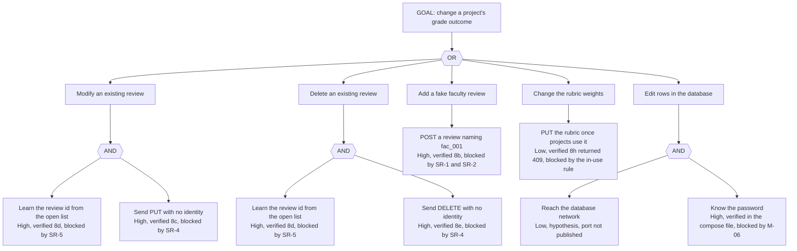
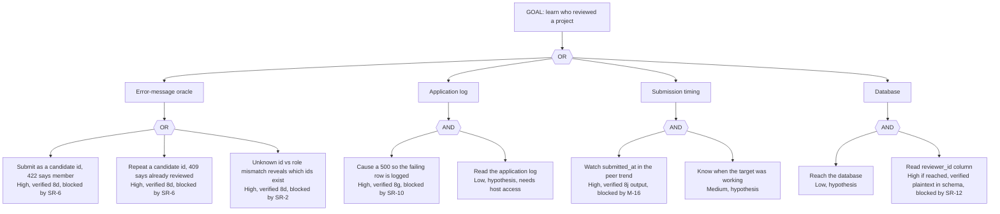
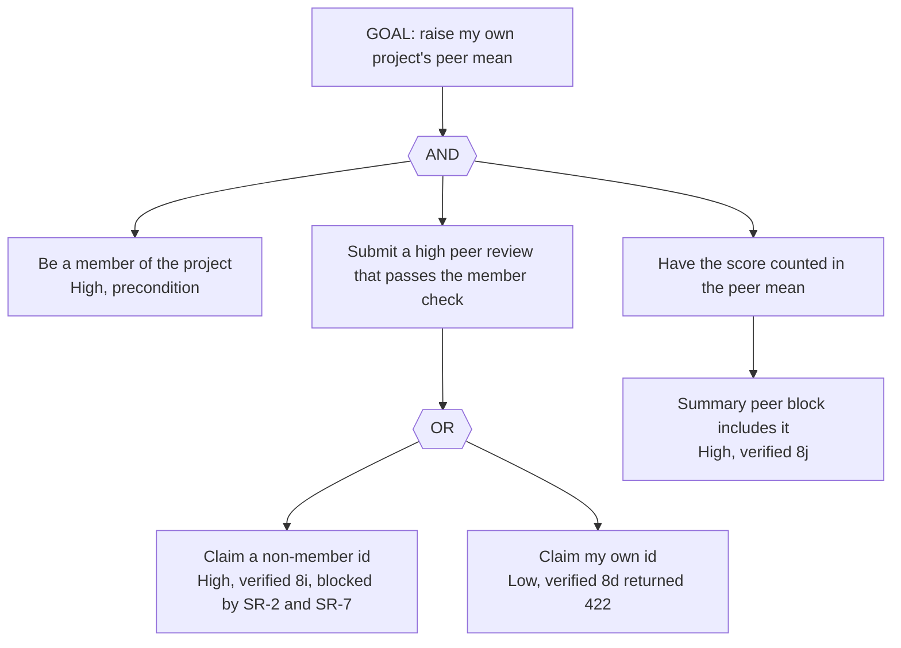
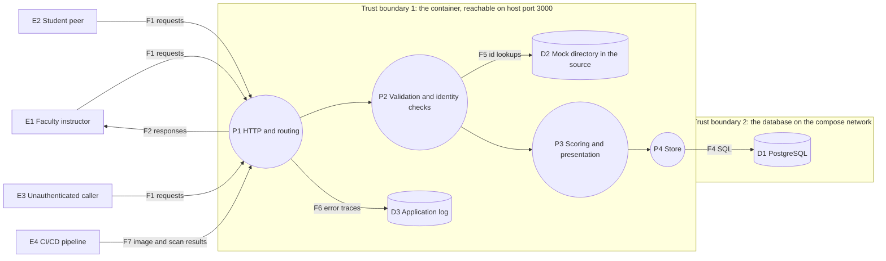

# Security Analysis: Peer Review & Evaluation Gateway (Assignment 2)

## AI Usage Log

- **Tool:** Claude (claude.ai chat, Claude Sonnet 5.5), 2026-11-16. The application code under analysis was generated by Claude Code 2.1.325 (`claude-opus-5-5`), a separate AI contribution logged in `assignment-2/.ai_logs/`.
- **Prompt Summary:** The chat proposed the security requirements, abuse cases, attack trees, attack surface map, DFD, STRIDE matrix and mitigations as options. I made the decisions (scope, which abuse cases and trees, rating scheme, diagram depth, the encrypted field) and ran the manual checks that the evidence tags below refer to. The methods follow the course's lecture content.
- **AI Contribution:** 90%
- **Human Modifications:** I decided on the scope of the full gateway, the abuse cases and attack trees, the diagram depth, and reviewer_id as the encrypted field. Claude suggested options and drafted the document, and I reviewed it. I ran all ten manual checks (8a to 8j) myself. I cut some unnecessary content by hand and had Claude remove the rest on my instruction to keep to the assignment's minimum requirements, and I chose to restore the user and abuser stories for a more comprehensive analysis.
- **Verification:** Every item tagged "verified" cites a check (8a to 8j) whose predicted and observed output is in `assignment-2/evidence/manual-verification.md`. Items tagged "inferred" follow from the code or the master specification but were not run. Items tagged "hypothesis" were not tested.
- **Confidence:** High for everything tagged "verified", because I ran those checks myself and each one cites its evidence. Medium for items tagged "inferred" or "hypothesis", since they were not run.
- **Chat share link:** https://claude.ai/share/5cf09fd2-4fdb-4649-999a-a7676f35bd22

---

## 1. Scope and assumptions

**Target.** The naive baseline of the Domain 3 Peer Review & Evaluation Gateway, `assignment-2/functional-codebase/` (Node/TypeScript, Express 5, PostgreSQL 17, Docker Compose). The `src/` and `test/` directories are unchanged since the baseline commit `aedffac`. The analysis builds on the four validated vulnerabilities V1 to V4 in `assignment-2/sast-triage-report.md`.

**Roles.** `faculty_instructor`, `student_peer`, and an unauthenticated caller.

**Assumptions.**
- Users and projects come from static mock data (`src/mock/`). Projects list their student `member_ids`.
- The service is single-tenant and calls no other service. Its only dependency is its own PostgreSQL database.
- Clarification this document adds to the master specification (the specification allows minor clarifications): the sensitive field that SR-12 protects is `reviewer_id` on `student_peer` reviews.

**Out of scope.** The other three domain services, the host operating system, and social engineering.

**Evidence tags.** *Verified* means observed in a manual check (the check id is given). *Inferred* means it follows from the code or specification but was not run. *Hypothesis* means untested.

**Risk ratings.** *High*: exploitable today with no credentials, and it changes or discloses grade data (observed). *Medium*: needs extra access, has limited impact, or is a deployment weakness. *Low*: minor or hypothetical.

---

## 2. Security requirements (defensive baseline)

Derived from CIA (confidentiality, integrity, availability) and AAA (authentication, authorization, accounting). Each traces to the evidence that motivated it.

| ID | Requirement | Property | Traces to |
|---|---|---|---|
| SR-1 | Every endpoint except `GET /health` requires a verifiable credential; otherwise the response is 401. | Authentication | V1, 8a |
| SR-2 | Caller identity and role come only from the verified credential, never from the request body. | Authentication | V1, 8b |
| SR-3 | Only `faculty_instructor` may create, change or delete rubrics. | Authorization | V1, 8a, 8h |
| SR-4 | Only a review's author may update or delete it. | Authorization | V2, 8c, 8e |
| SR-5 | Faculty may read all reviews, both summary blocks and reports. A `student_peer` may read only their own reviews and the `student_peer` block of the summary for a project they are a member of. Nothing else. | Authorization, confidentiality | V1, 8c, 8d |
| SR-6 | A `student_peer`'s identity is never disclosed to anyone: not in responses, not in logs, not through differences between error responses. | Confidentiality | V3, V4, 8d, 8g |
| SR-7 | A `student_peer` cannot review a project they are a member of, checked against the verified identity. | Integrity | V3, 8d, 8i |
| SR-8 | Write inputs are validated: weights, points and ids are bounded, and no `NaN` or `Infinity` score is ever computed or stored. | Integrity | V4, 8f |
| SR-9 | Security-relevant actions (rubric writes, review create, update and delete, denied requests) leave an audit record naming the verified actor. | Accounting | V2 (no actor trace) |
| SR-10 | Error responses are generic, and server errors leak no internals or identities. | Confidentiality, availability | V4, 8g |
| SR-11 | The runtime image carries no known high or critical vulnerabilities. | Integrity | Trivy image scan, 20 findings |
| SR-12 | `reviewer_id` on `student_peer` reviews is encrypted at the application layer, with the key read from an environment variable and never committed. | Confidentiality | T-13 |

### User stories and acceptance criteria

Each story is small and testable, so each criterion can be turned directly into a test.

| Story | Acceptance criteria |
|---|---|
| **US-1** As a service owner, I want every request authenticated, so that each action has a real actor (SR-1, SR-2). | No token returns 401. An expired or tampered token returns 401. A `reviewer_id` in the body that differs from the token is ignored or rejected. `GET /health` stays 200 with no token. |
| **US-2** As an instructor, I want rubrics controlled only by faculty (SR-3). | A student token on POST, PUT or DELETE of a rubric returns 403. A faculty token returns 201, 200 or 204 (or 409 when the rubric is in use). |
| **US-3** As a reviewer, I want only myself to be able to change my review (SR-4). | Another user's PUT or DELETE on my review returns 403 and the review is unchanged. My own PUT or DELETE returns 200 or 204. |
| **US-4** As a student, I want to see only what my role allows (SR-5). | A student `GET /reports` returns 403. A student `GET` of another user's review returns 403. A student `GET` of the summary of a project they belong to returns 200 with the peer block only. A non-member gets 403. Faculty see both blocks. |
| **US-5** As a peer reviewer, I want my identity protected (SR-6, SR-7). | No response, log line or error contains a peer's `reviewer_id`. No response lets a caller tell whether another user is a member of a project or has reviewed it. A member's review of their own project returns 403. |
| **US-6** As a grader, I want scores that cannot be corrupted (SR-8, SR-10). | A weight above the cap, negative points, or points above `max_points` return 422. No stored `overall_score` is `NaN`, `Infinity` or outside 0 to 100. A forced server fault returns a generic 500 body. |

The stories were written to the INVEST characteristics (small, valuable, testable). US-1 is a prerequisite for US-2 to US-5, so those four are not fully independent of it.

Three of the criteria as Given/When/Then test cases:
- **US-1.** Given a request with no token, when it calls `POST /api/v1/evaluations/rubrics`, then the response is 401 and nothing is created.
- **US-3.** Given a review written by `fac_001` and a valid token for `fac_002`, when `fac_002` sends a PUT on that review, then the response is 403 and the review is unchanged.
- **US-5.** Given a valid token for a student who is a member of `proj_101`, when they POST a review for `proj_101`, then the response is 403.

Acceptance criteria for the requirements without a story:
- **SR-9.** After any rubric write or review change, an audit record exists with the verified actor, action, target id and time, and denied requests are recorded too. Because SR-6 forbids exposing a peer's identity, a peer actor is recorded as a keyed hash that only an administrator holding the key can link back.
- **SR-11.** A Trivy scan of the runtime image reports no HIGH or CRITICAL findings.
- **SR-12.** The `reviewer_id` column of a stored peer review holds ciphertext. The service refuses to start if the key variable is missing. The one-review-per-reviewer rule still works, which needs a keyed lookup value (for example an HMAC) next to the ciphertext.

---

## 3. Abuse cases

An abuse case is a requirement seen from the attacker's side. The table lists them, and each is then restated as an abuser story.

| ID | Abuse case (attacker's goal) | Attacker | Technique | Breaks | Evidence |
|---|---|---|---|---|---|
| AC-1 | Plant a fake faculty grade | Outsider | POST a review naming `fac_001` in the body | SR-1, SR-2 | Verified, 8b |
| AC-2 | Rewrite or erase a real grade | Outsider or a student rival | Read the review id from the open list, then PUT or DELETE it | SR-4 | Verified, 8c, 8e |
| AC-3 | Unmask who reviewed a project | Student or outsider | Probe the 409 and 422 messages; read the log after a forced 500 | SR-6, SR-10 | Verified, 8d, 8g |
| AC-4 | Inflate my own project's peer score | Member of the project | Claim a non-member's id in the body | SR-2, SR-7 | Verified, 8i |
| AC-5 | Lock a course or lab to a worthless rubric | Outsider | Create an unauthenticated rubric scoped to the course; the in-use rule then blocks changes | SR-3 | Verified for one project (8a, 8h); course scope inferred from project decision 9 |
| AC-6 | Corrupt or crash scoring | Outsider | Submit a rubric with `1e308` weights | SR-8 | Verified, 8f |
| AC-7 | Read every grade and report | Outsider | GET reviews, summary and reports with no credentials | SR-1, SR-5 | Verified for reviews and summary (8c, 8d, 8j); reports not exercised |
| AC-8 | Knock the service over | Outsider | Flood or oversized requests | Availability | Hypothesis, not tested |
| AC-9 | Exploit a vulnerable component in the image | Outsider with a foothold | Target the bundled npm packages that Trivy flagged | SR-11 | Scanner finding; exploitability not tested |
| AC-10 | Skew a project's peer mean by ballot stuffing | Outsider | Submit peer reviews under every non-member student id | SR-1, SR-2 | Verified, 8j |
| AC-11 | Read reviewer identities straight from the database | Insider or anyone holding the database credential | Connect to PostgreSQL with the credential written in the compose file | SR-6, SR-12 | Hypothesis; the credential's presence in the compose file is verified from the file |

### Abuser stories

- **AC-1.** As an outsider, I want to submit a review that names a faculty member, so that a grade appears to come from an instructor.
- **AC-2.** As a student rival or rogue instructor, I want to overwrite or delete another reviewer's review, so that a project's grade changes in my favour or disappears.
- **AC-3.** As a curious student, I want to learn who reviewed a project, so that I can identify and pressure the anonymous peers.
- **AC-4.** As a project member, I want to submit a top-score peer review under someone else's id, so that my own project's peer score rises.
- **AC-5.** As an outsider, I want to create a rubric for a whole course before the instructor does, so that every project is bound to my rubric and cannot be rebound.
- **AC-6.** As an outsider, I want to submit a rubric with enormous weights, so that scores are silently wrong or the service fails.
- **AC-7.** As an outsider, I want to download every review, summary and report, so that I can see all grades.
- **AC-8.** As an outsider, I want to flood the service with requests, so that instructors cannot use it.
- **AC-9.** As an attacker with a foothold in the container, I want to use a vulnerable bundled component, so that I gain more access.
- **AC-10.** As an outsider, I want to submit peer reviews under several student ids, so that I can push a project's peer mean to a value I choose.
- **AC-11.** As someone with the database credential, I want to read the reviews table directly, so that I can read peer identities without going through the API.

---

## 4. Attack trees

Each tree puts one abuse case at the root. A gate marked OR means any child achieves the parent. A gate marked AND means every child must succeed. Each leaf shows its feasibility today (High, Medium or Low), its evidence tag and the requirement or mitigation that would block it.

### Tree 1: Alter or erase a recorded grade (AC-1, AC-2)

The tree shows that the open API is the cheap route, and that the one control that already exists (the in-use rule) closes the rubric route. The database route needs network access that the compose file does not give from outside.

### Tree 2: Unmask a peer reviewer (AC-3)

The error oracles are the cheapest and most reliable route, and all of them disappear once identity comes from a verified credential. The log and database routes depend on access that an outside caller does not have today.

### Tree 3: Inflate my own project's peer score (AC-4)

The member check works only on the id typed in the body, so the one control that exists is defeated by naming someone else. Fixing SR-2 (identity from the verified credential) makes the check meaningful.

---

## 5. Attack surface map

The only network entry into the system is host port 3000 on the app container; the compose file publishes no port for PostgreSQL. Ratings use the scale in section 1.

### HTTP entry points (13)

| # | Entry point | Authentication today | Accepts | Risk | Why |
|---|---|---|---|---|---|
| 1 | `GET /health` | none (intended) | nothing | Low | Returns 200 only |
| 2 | `POST /api/v1/evaluations/rubrics` | none | JSON rubric with weights and scope | High | Anyone can create and lock rubrics (8a, 8h); unbounded weights (8f) |
| 3 | `GET /api/v1/evaluations/rubrics` | none | query filters | Low | Rubric content is not sensitive |
| 4 | `GET /api/v1/evaluations/rubrics/{id}` | none | path id | Low | Same |
| 5 | `PUT /api/v1/evaluations/rubrics/{id}` | none | JSON rubric | Medium | Open, but blocked once a project uses the rubric (8h) |
| 6 | `DELETE /api/v1/evaluations/rubrics/{id}` | none | path id | Medium | Same |
| 7 | `GET /api/v1/evaluations/projects/{id}/summary` | none | path id | High | Both blocks to anyone; peer timestamps in the trend (8j) |
| 8 | `POST /api/v1/evaluations/projects/{id}/reviews` | none | JSON review with `reviewer_id` and role | High | Forged identity, stuffing, error oracles (8b, 8d, 8i, 8j) |
| 9 | `GET /api/v1/evaluations/projects/{id}/reviews` | none | query `min_score` | High | All raw reviews; faculty ids shown (8d) |
| 10 | `GET /api/v1/evaluations/projects/{id}/reviews/{rid}` | none | path ids | High | Raw review and feedback to anyone |
| 11 | `PUT /api/v1/evaluations/projects/{id}/reviews/{rid}` | none | JSON review | High | Any grade rewritable (8c) |
| 12 | `DELETE /api/v1/evaluations/projects/{id}/reviews/{rid}` | none | path ids | High | Any grade erasable (8e) |
| 13 | `GET /api/v1/evaluations/reports` | none | query `course_id`, `lab_id` | High | Consolidated grades for a whole course or lab; registered with no middleware, not exercised by hand (inferred) |

### Other entry points and exposures

| # | Entry point | Risk | Why |
|---|---|---|---|
| N1 | PostgreSQL inside the compose network | Medium | Not published to the host. The credential is written in `docker-compose.yml`, and `reviewer_id` is stored in plaintext |
| N2 | Runtime container image | Low | Runs as the non-root `node` user. Trivy found 20 findings, 19 in npm's bundled packages and one in zlib (triage report 3.4) |
| N3 | CI pipeline and repository secrets | Medium | The Trivy container tag and the Semgrep `pip` install are not pinned; the SonarQube job uses a repository secret |
| N4 | Application log (stdout) | Medium | Server errors write the failing row, including `reviewer_id` (8g); anyone with host access could also alter it |
| N5 | Static mock directory in the source | Medium | User and project ids are public and predictable, which supports V1 and AC-10 |
| N6 | Plain HTTP on port 3000 | Medium | The compose file publishes the port and sets no TLS options (inferred; see T-15) |

**Highest-risk vectors:** the review write endpoints (8, 11, 12), `POST` rubrics (2), and the endpoints that return grade data (7, 9, 10, 13). Every one of them is open to an unauthenticated caller today.

---

## 6. Data flow diagram and STRIDE

### 6.1 Data flow diagram

### 6.2 STRIDE matrix

Every DFD element is scored against all six categories. A cell holds the id of a threat from 6.3, or "n/a" when the category does not apply to that kind of element. Which categories apply follows the lecture's STRIDE mapping: actors (S, R, E), processes (S, T, I, D, E), data stores and data flows (T, I, D). I also scored Repudiation on the processes and stores where the audit trail lives, because SR-9 needs it there.

| Element | S Spoofing | T Tampering | R Repudiation | I Information disclosure | D Denial of service | E Elevation of privilege |
|---|---|---|---|---|---|---|
| E1 Faculty instructor | T-01 | n/a | T-09 | n/a | n/a | n/a |
| E2 Student peer | T-01 | n/a | T-09 | n/a | n/a | T-02 |
| E3 Unauthenticated caller | T-01 | n/a | T-09 | n/a | n/a | T-02 |
| E4 CI/CD pipeline | T-08 | T-08 | n/a | n/a | n/a | n/a |
| P1 HTTP and routing | T-01 | T-04 | T-09 | T-12, T-15 | T-16, T-17 | T-17 |
| P2 Validation and identity checks | T-01 | T-05, T-06 | T-09 | T-11 | T-05 | T-02 |
| P3 Scoring and presentation | n/a | T-05 | n/a | T-14 | T-05 | n/a |
| P4 Store | n/a | T-03, T-04 | T-09 | T-10 | n/a | T-03 |
| D1 PostgreSQL | n/a | T-07 | T-09 | T-07, T-13 | T-16 | n/a |
| D2 Mock directory | n/a | T-08 | n/a | T-11 | n/a | n/a |
| D3 Application log | n/a | T-18 | T-09 | T-12 | T-16 | n/a |
| F1 Client requests | n/a | T-01 | n/a | T-15 | T-16 | n/a |
| F4 SQL to D1 | n/a | T-07 | n/a | T-07 | T-16 | n/a |
| F6 Error traces to D3 | n/a | n/a | n/a | T-12 | T-16 | n/a |

### 6.3 Threat register

| ID | Threat | STRIDE | Element | CWE | Rating | Evidence | Mitigation |
|---|---|---|---|---|---|---|---|
| T-01 | Caller identity forged in the request body | S | P1, P2, F1 | CWE-306, CWE-290 | High | Verified, 8a, 8b, 8i, 8j | M-01 |
| T-02 | Role asserted in the body, so any caller acts as faculty | E | P2 | CWE-306 | High | Verified, 8b | M-01 |
| T-03 | Any caller rewrites or deletes any review | T, E | P4 | CWE-639 | High | Verified, 8c, 8e | M-02 |
| T-04 | Any caller creates rubrics, and a bound rubric is then locked | T, D | P1, P4 | CWE-862 | High | Verified, 8a, 8h | M-03 |
| T-05 | Unbounded weights or points corrupt scores or cause 500s | T, D | P2, P3 | CWE-1284 | Medium | Verified, 8f | M-04 |
| T-06 | Ballot stuffing and self-inflation under claimed ids | T | P2 | CWE-290 | High | Verified, 8i, 8j | M-01, M-05 |
| T-07 | Database read or changed by whoever holds the hardcoded credential | T, I | D1, F4 | CWE-798 | Medium | Credential verified in the compose file; misuse is a hypothesis | M-06, M-12 |
| T-08 | Unpinned CI tools alter the build output (including the mock directory) or the scan results | S, T | E4, D2 | CWE-829 | Medium | Hypothesis | M-07 |
| T-09 | No verified actor is recorded for any change | R | all | CWE-778 | Medium | Inferred; `updated_at` only (V2) | M-08 |
| T-10 | Unauthenticated read of all reviews, summaries and reports | I | P4 | CWE-306, CWE-862 | High | Verified for reviews and summary (8c, 8d, 8j); reports not exercised | M-09 |
| T-11 | Error responses unmask peers and reveal which ids exist | I | P2, D2 | CWE-204 | Medium | Verified, 8d | M-10 |
| T-12 | Reviewer id written to the log on server errors | I | P1, D3, F6 | CWE-532 | Medium | Verified, 8g | M-11 |
| T-13 | Reviewer id stored in plaintext | I | D1 | CWE-312 | Medium | Verified in the schema | M-12 |
| T-14 | Peer submission timestamps visible in the summary trend | I | P3 | CWE-200 | Low | Verified in 8j output | M-16 |
| T-15 | Plain HTTP transport exposes data in transit | I | P1, F1 | CWE-319 | Medium | Inferred from the compose file | M-13 |
| T-16 | No request budget, so flooding is possible (and can exhaust the database connections or fill the log) | D | P1, D1, D3, F1, F4, F6 | CWE-770 | Medium | Hypothesis, not tested | M-14 |
| T-17 | Image carries vulnerable bundled components | T, D, E | P1 | CWE-1395 | Low | Scanner finding, exploitability not tested | M-15 |
| T-18 | Log records altered or deleted by someone with host access | T | D3 | none specific | Low | Hypothesis | M-08 |

---

## 7. Proposed mitigations

Every vulnerability (V1 to V4 and the scanner findings) and every threat above maps to at least one mitigation.

| ID | Mitigation | Type | Addresses |
|---|---|---|---|
| M-01 | Authentication middleware that verifies a signed token on every request (asymmetric signature, an algorithm allowlist that rejects `none` and HS256, and checks on `exp`, `iss` and `aud`) and takes identity and role only from its claims; the body's `reviewer_id` and role are ignored | Preventive | T-01, T-02, T-06; V1, SR-1, SR-2 |
| M-02 | Row-level authorization on reviews: only the author may update or delete | Preventive | T-03; V2, SR-4 |
| M-03 | Role check on rubric writes: faculty only | Preventive | T-04; AC-5, SR-3 |
| M-04 | Bounded validation: maximum weight, point and criterion counts, finite numbers only; refuse to compute a score that is not finite | Preventive | T-05; V4, SR-8 |
| M-05 | Conflict-of-interest and uniqueness checks against the verified identity | Preventive | T-06; AC-4, AC-10, SR-7 |
| M-06 | Take the database credential from the environment or a secret store, use a least-privilege database role, and keep the port unpublished | Preventive | T-07; AC-11, N1 |
| M-07 | Pin the Trivy container by digest and Semgrep by version and hash | Preventive | T-08; N3 |
| M-08 | Audit log with the verified actor, action, target and time; a peer actor is stored as a keyed hash so SR-6 still holds; the log is append-only or shipped off the host | Detective | T-09, T-18; SR-9 |
| M-09 | Read scoping by role and project membership on reviews, summary and reports | Preventive | T-10; AC-7, SR-5 |
| M-10 | Uniform error responses that do not depend on who else exists or has reviewed | Preventive | T-11; V3, SR-6 |
| M-11 | Log hygiene: strip row contents and identities from error logs and log structured request ids instead | Corrective | T-12; V4, SR-10 |
| M-12 | Application-layer encryption of `reviewer_id` (authenticated encryption, key from an environment variable) with a keyed lookup value (for example an HMAC) so the one-review-per-reviewer rule still works | Preventive | T-07, T-13; AC-11, SR-12 |
| M-13 | Terminate TLS in front of the service and send HSTS | Preventive | T-15; N6 |
| M-14 | Rate limiting, request timeouts and the existing body size limit | Preventive | T-16; AC-8 |
| M-15 | Remove npm from the runtime stage, or rebuild on a patched base image pinned by digest | Preventive | T-17; AC-9, SR-11; Trivy image findings |
| M-16 | Remove or coarsen `submitted_at` in the peer block of the summary | Preventive | T-14 |

The two SonarQube findings in the triage report (S-1 and S-2) are code-quality issues with no security effect and are fixed in place.
