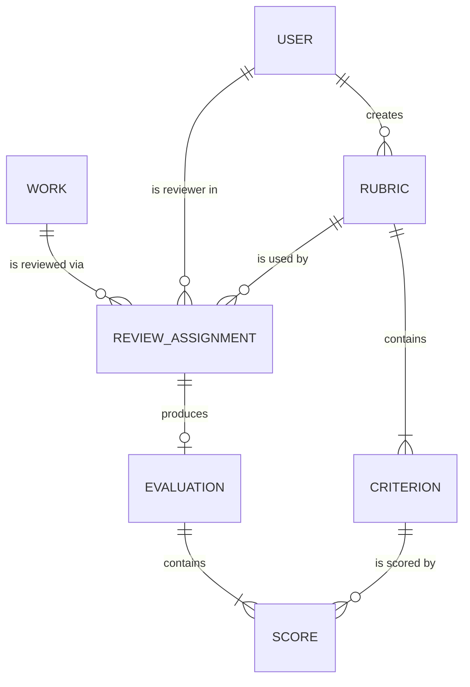

# spec.md - Peer Review & Evaluation Gateway (Domain 3)

## AI Usage Log (required on first page)
- **Conceptual AI contribution:** [__]% AI / [__]% human  <- fill in honestly
- **Tool(s):** <e.g. Claude chat (claude.ai) for drafting this spec; Claude Code for implementation>
- **Chat link / exported appendix:** <paste share link or attach export>
- **Design-aid prompts used:** <paste the exact prompts>

---

## 1. Purpose and scope
The Peer Review & Evaluation Gateway is a single-tenant REST service of the Project Portal (PP). It lets faculty, course instructors, and student peers evaluate published works using structured rubrics, and aggregates the resulting scores.

**In scope:** rubric and criteria management, reviewer assignment, evaluation drafting/submission, score aggregation.
**Out of scope:** hosting works (Domain 1), resource allocation (Domain 2), discussion feeds (Domain 4). Those are represented only by **static mock data** (section 9). No calls to other services.

## 2. Tech stack
| Layer | Choice |
|---|---|
| Runtime / language | Node.js 24 LTS, TypeScript 5.9 (strict) |
| Framework | Express 5 |
| Database | PostgreSQL 17 (single-tenant container in docker-compose) |
| Testing | Vitest + Supertest |
| Packaging | Multi-stage Docker, docker-compose |
| CI/CD | GitHub Actions: Trivy, Semgrep, SonarQube |

## 3. Actors and roles
| Role | Can do |
|---|---|
| `instructor` | Create/edit/delete rubrics; assign reviewers; view all evaluations and summaries |
| `faculty` | Review assigned works; view summaries for works they are assigned to |
| `student` (peer) | Review assigned works; view own evaluations; view published summary of own work |

Phase 1 identity is mocked: requests carry `X-Mock-User-Id` referencing a mock user (section 9). Real authentication/authorization (JWT, row-level rules) is introduced in Assignment 3.

## 4. Data model


| Entity | Fields (type, constraints) |
|---|---|
| **User** (mock) | `id` string PK, `name`, `role` enum(instructor, faculty, student), `email` |
| **Work** (mock) | `id` string PK, `title`, `ownerIds` string[], `courseId`, `publishedAt` |
| **Rubric** | `id` PK, `title` (1-120), `description`, `createdBy` FK User, `createdAt`, `updatedAt` |
| **Criterion** | `id` PK, `rubricId` FK, `name`, `description`, `maxScore` int 1-100, `weight` int 1-100 (weights per rubric sum to 100) |
| **ReviewAssignment** | `id` PK, `workId`, `reviewerId` FK, `reviewerRole`, `rubricId` FK, `dueDate`, `status` enum(pending, in_progress, completed); UNIQUE(workId, reviewerId) |
| **Evaluation** | `id` PK, `assignmentId` FK UNIQUE, `status` enum(draft, submitted), `comment` (<=2000), `submittedAt` nullable |
| **Score** | `id` PK, `evaluationId` FK, `criterionId` FK, `value` int 0..criterion.maxScore, `comment` (<=500); UNIQUE(evaluationId, criterionId) |

## 5. Business rules
1. A rubric's criterion weights must total exactly 100 before the rubric can be used in an assignment.
2. A rubric cannot be deleted once any assignment references it (409).
3. A reviewer cannot be assigned to a work they own (422).
4. One assignment per (work, reviewer); one evaluation per assignment.
5. Scores must be within `0..maxScore`; submitting requires a score for every criterion.
6. Submitted evaluations are immutable.
7. Aggregation (section 7) uses only `submitted` evaluations.

## 6. REST API (base path `/api/v1`)
All bodies are JSON. Errors use `{"error":{"code","message","details?"}}` with codes `VALIDATION_ERROR` (400), `NOT_FOUND` (404), `CONFLICT` (409), `UNPROCESSABLE` (422).

| # | Method & path | Purpose | Success |
|---|---|---|---|
| 1 | `GET /health` (unversioned, outside `/api/v1`) | Liveness | 200 |
| 2 | `GET /users/me` | Current mock user | 200 |
| 3 | `POST /rubrics` | Create rubric with criteria | 201 |
| 4 | `GET /rubrics` | List rubrics (`?page&pageSize`) | 200 |
| 5 | `GET /rubrics/{rubricId}` | Get rubric + criteria | 200 |
| 6 | `PUT /rubrics/{rubricId}` | Update rubric metadata | 200 |
| 7 | `DELETE /rubrics/{rubricId}` | Delete unused rubric | 204 |
| 8 | `POST /rubrics/{rubricId}/criteria` | Add criterion | 201 |
| 9 | `PUT /rubrics/{rubricId}/criteria/{criterionId}` | Update criterion | 200 |
| 10 | `DELETE /rubrics/{rubricId}/criteria/{criterionId}` | Remove criterion | 204 |
| 11 | `GET /works` | List mock published works | 200 |
| 12 | `GET /works/{workId}` | Get one mock work | 200 |
| 13 | `POST /works/{workId}/assignments` | Assign a reviewer | 201 |
| 14 | `GET /works/{workId}/assignments` | List assignments for a work | 200 |
| 15 | `GET /assignments?reviewerId=` | List assignments for a reviewer | 200 |
| 16 | `DELETE /assignments/{assignmentId}` | Remove assignment (no submitted evaluation) | 204 |
| 17 | `POST /assignments/{assignmentId}/evaluation` | Start draft evaluation | 201 |
| 18 | `GET /evaluations/{evaluationId}` | Get evaluation + scores | 200 |
| 19 | `PUT /evaluations/{evaluationId}/scores` | Upsert scores (draft only) | 200 |
| 20 | `POST /evaluations/{evaluationId}/submit` | Submit (immutable) | 200 |
| 21 | `GET /works/{workId}/evaluations` | List submitted evaluations for a work | 200 |
| 22 | `GET /works/{workId}/summary` | Aggregated results | 200 |

### 6.1 Key payload schemas
**Create rubric** `POST /rubrics`
```json
{
  "title": "Capstone Project Rubric",
  "description": "Standard rubric for course capstone projects.",
  "criteria": [
    { "name": "Technical Quality", "description": "...", "maxScore": 10, "weight": 40 },
    { "name": "Innovation",        "description": "...", "maxScore": 10, "weight": 20 },
    { "name": "Documentation",     "description": "...", "maxScore": 10, "weight": 20 },
    { "name": "Presentation",      "description": "...", "maxScore": 10, "weight": 20 }
  ]
}
```
Response 201: the Rubric with generated `id`, `createdBy`, `createdAt`, and criteria `id`s.

**Assign reviewer** `POST /works/{workId}/assignments`
```json
{ "reviewerId": "usr-stu-02", "reviewerRole": "student", "rubricId": "rub-001", "dueDate": "2026-12-15T23:59:00Z" }
```

**Upsert scores** `PUT /evaluations/{evaluationId}/scores`
```json
{
  "comment": "Strong implementation, thin docs.",
  "scores": [
    { "criterionId": "crit-001", "value": 9, "comment": "Clean architecture" },
    { "criterionId": "crit-003", "value": 6 }
  ]
}
```

**Summary** `GET /works/{workId}/summary`
```json
{
  "workId": "work-001",
  "evaluationCount": 3,
  "byRole": { "instructor": 88.5, "faculty": 84.0, "student": 79.0 },
  "overall": 85.2,
  "byCriterion": [
    { "criterionId": "crit-001", "name": "Technical Quality", "meanPercent": 90.0, "stdDev": 4.1 }
  ]
}
```

## 7. Aggregation algorithm
For each submitted evaluation: `percent = sum(weight_i * value_i / maxScore_i)` (weights sum to 100, so result is 0-100).
`byRole[r]` = mean of percents for role `r`. `overall` = weighted mean of `byRole` using role weights `instructor 0.5, faculty 0.3, student 0.2`, **renormalised over the roles that have at least one submitted evaluation**. Round to 1 decimal. `byCriterion` reports mean percent and population standard deviation across submitted evaluations.

## 8. Non-functional requirements
Stateless service; config via env vars (`PORT`, `DATABASE_URL`); structured JSON errors; pagination defaults `page=1,pageSize=20` (max 100); runs under docker-compose with a single Postgres container; health check at `/health`.

## 9. Static mock data
Mock users and works are loaded from in-repo constants (never fetched from other services).
```json
{
  "users": [
    { "id": "usr-inst-01", "name": "Prof. Rivera", "role": "instructor" },
    { "id": "usr-fac-01",  "name": "Dr. Chen",     "role": "faculty" },
    { "id": "usr-stu-01",  "name": "Alex Kim",     "role": "student" },
    { "id": "usr-stu-02",  "name": "Sam Patel",    "role": "student" },
    { "id": "usr-stu-03",  "name": "Jordan Lee",   "role": "student" }
  ],
  "works": [
    { "id": "work-001", "title": "Smart Campus Energy Dashboard", "ownerIds": ["usr-stu-01"], "courseId": "CS701", "publishedAt": "2026-10-20T00:00:00Z" },
    { "id": "work-002", "title": "Accessible Transit Planner",    "ownerIds": ["usr-stu-02", "usr-stu-03"], "courseId": "CS701", "publishedAt": "2026-10-22T00:00:00Z" }
  ],
  "rubrics": [ "see src/data/mock.ts (rub-001, 4 criteria, weights 40/20/20/20)" ]
}
```

## 10. Acceptance criteria for Assignment 1
`docker compose up` starts app + db; `GET /health` returns 200; `GET /api/v1/rubrics` returns the mock rubric; CI pipeline completes with all scanners reporting (non-blocking).
